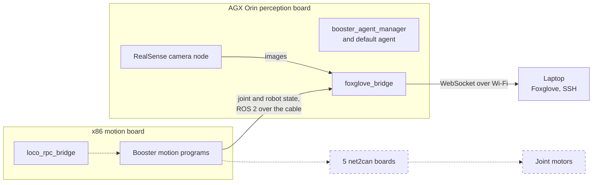
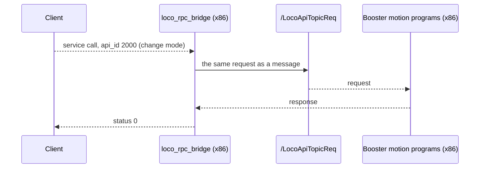

---
doc:
  quadrant: explanation
  verified_on: "software 1.8.0.9, both boards"
---
# System architecture

This page explains how COSMO's software is spread over its two computers, how the two act as one ROS 2 system, and how data and commands move through it. The details are on the reference pages: [[hardware-overview]], [[software_overview]], [[ros-interfaces]] and [[rpc_api]]. Values marked (software 1.6.2.2) were not checked on 1.8.0.9.

## Two computers, two jobs

| Board | Job | Hardware it owns |
|---|---|---|
| x86 motion board | Motion: modes, walking, joint control | the motors and the joystick receiver |
| AGX Orin perception board | Perception and interaction: camera, audio, agents | the head camera and the audio devices |

The x86 board has a real-time kernel. [INFERENCE] The reason is the motion loop, which must run at a fixed rate. The Orin has the GPU and the AI libraries.

A board publishes the topics of the hardware it owns. Camera topics start on the Orin. Joint and IMU topics start on the x86 board (software 1.6.2.2). A program that needs data from the other board gets it through ROS 2, over the cable between the boards.

[INFERENCE] The x86 board sends motor commands as network packets to five net2can boards, which pass them on to the motors over CAN. Neither board uses a CAN port of its own. See [[hardware-overview#Motor bus]].

Solid line: observed. Dashed box or line: inferred, not observed directly.

## Start-up

On each board, one systemd service starts Booster's own `containerd`, and that starts the Booster programs. Most Booster programs are therefore not separate systemd services, and `systemctl` shows only the top of the chain. Which program runs where: [[software_overview#Programs]].

The football team uses the same robot. Programs and files on the boards can belong to them.

## One ROS 2 system on two boards

The Fast DDS profile of the login shells allows only two ways to send data: UDP on the loopback address and the two wired addresses, and shared memory inside one board. This has three consequences:

- **The two boards form one ROS 2 graph.** Each board lists the topics of the other.
- **A laptop on Wi-Fi is outside the graph.** [INFERENCE] The profile contains no Wi-Fi address, so a laptop cannot subscribe directly. A bridge program on the Orin, such as `foxglove_bridge`, forwards the data.
- **Shared memory can hide topics from a bridge.** A `foxglove_bridge` on the Orin with this profile receives the x86 topics but not the camera topics of its own board (software 1.6.2.2). A UDP-only profile solves it. See [[software_overview#Known problems]].

## Three layers of control

A program can control COSMO at three levels. The higher the level, the more Booster's software decides.

| Layer | What a program sends | Where to read more |
|---|---|---|
| Agent | A packaged application on the Orin, run by `booster_agent_manager` | [[software_overview#Booster agents]] |
| RPC | One request, such as "change mode" or "move the head" | [[rpc_api]] |
| Joints | Motor commands on `/joint_ctrl` (`LowCmd`) | [[ros-interfaces#LowCmd and MotorCmd]] |

[UNVERIFIED] Joint commands work only in Custom mode; our program then has to keep the balance itself. [UNKNOWN] How agents pass their commands on to the motion programs.

## How a command travels

A client calls the service `/booster_rpc_service` with an `api_id` and a `body`.

Solid arrow: observed. Dashed arrow: inferred, not observed directly. The client gets status 0 and `loco_rpc_bridge` logs the request; that `loco_rpc_bridge` itself serves the call is inferred.

- **The same request has two forms.** The service has `api_id` and `body`. The topic has a `uuid`, a JSON `header` and a `body`; the `uuid` links a response to its request (software 1.6.2.2).
- **Requests are visible to everyone.** Every program in the graph can see what is sent on `/LocoApiTopicReq`, also by other users of the robot.
- **Status 0 is not the end of the movement.** [UNVERIFIED] It means that the request was accepted. Check the mode in `/robot_states`.

The joystick takes another route, through the agent manager on the Orin: [[control_with_joystick#How a button press reaches the motors]].

> [!warning]
> `/booster_rpc_service`, `/joint_ctrl` and the `*ApiTopicReq` topics can move COSMO. Do not publish to them or call them without knowing what they do.

## How data travels

| Data | Starts on | Rate |
|---|---|---|
| Joint, motor, IMU and odometry state | x86 board (software 1.6.2.2) | 500 Hz |
| Colour and depth images | Orin | 30 Hz |
| Mode (`/robot_states`) | [UNKNOWN] | 2 Hz |
| Fall state (`/fall_down`) | [UNKNOWN] | 1 Hz |

- **Raw images are too large for Wi-Fi.** The raw colour image is about 83 MB/s. Through the bridge it reached 8.6 MB/s and under 5 fps. A program on the Orin that sends 640x360 JPEG images at 10 Hz gives usable video.
- **Image processing belongs on the Orin.** [INFERENCE] The cable between the boards cannot carry the raw colour and depth images together.
- **The robot's `/tf` has only head frames.** [INFERENCE] A whole-body tree must be built from the joint states, the odometry and a URDF.

## Open questions

- [UNKNOWN] What `loco_rpc_bridge` sends on to the motion programs, and how.
- [UNKNOWN] What the four serial ports of the x86 board carry.
- [UNKNOWN] Whether a laptop on the wired `192.168.10.x` network can join the graph.
- [UNKNOWN] Why `/tf` has only head frames.
- [UNKNOWN] Whether third-party agents are supported.
