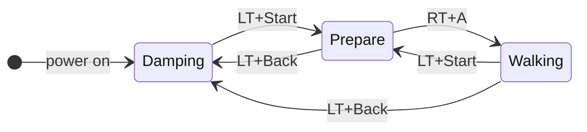

---
doc:
  order: 4
  quadrant: how-to
---
# Control COSMO with the joystick

> [!warning] Review needed
> This page has not been reviewed by the team yet.

> [!info] Applies to software 1.8.0.9 on both boards.

Use the joystick to put COSMO in a mode, walk it, and put it back on its stand.

> [!warning]
> The buttons and steps below are [UNVERIFIED] on COSMO unless a line says otherwise. First try only `LT+Start` and `LT+Back`, with COSMO on its stand.
>
> - `LT+Back` (Damping) lets a standing robot fall: support it first.
> - `LT+Back` is not an independent emergency stop. [UNVERIFIED] It is refused while another mode change is still in progress, and it needs both boards (see [below](#how-a-button-press-reaches-the-motors)).
> - [UNKNOWN] What the emergency stop does to the joints. Do not rely on it to hold COSMO up.

## Buttons

| Button | Effect | Condition |
|---|---|---|
| `LT+Back` | Damping: joints resist motion but do not hold; COSMO cannot stand | Any mode |
| `LT+Start` | Prepare: COSMO holds a standing pose, without balancing | - |
| `RT+A` | Walking; COSMO steps in place while the sticks are centred | From Prepare, feet on the ground |
| Left stick | Walk forward, backward and sideways | Walking |
| Right stick, left/right | Turn | Walking |
| Right stick, up/down | Walk forward or backward while the left stick is centred in that direction | Walking |
| Direction buttons | Move the head: up and down pitch, left and right yaw | Walking |

A mode button works only when exactly the two buttons of the combination are pressed: hold `LT` or `RT` first, then press the other button. Releasing both sticks commands zero velocity; COSMO may still step in place. [UNKNOWN] What COSMO does when the joystick loses its connection.

> [!danger]
> `RT+Y` and `RT+X` are not the Prepare and Damping buttons on this software. Some older instructions still show them. [UNVERIFIED] They now control voice functions.
>
> [UNVERIFIED] Other combinations start gestures, dances, a kick, getting up or another agent. Press only the buttons on this page.

## Walk

1. Hang COSMO on its stand and keep the area around it clear. Keep the joystick in hand and the emergency stop within reach. Do not touch COSMO while it walks, except its handle.
2. Press `LT+Start`. COSMO takes its standing pose.
3. Put COSMO on the ground and check that it stands firmly on both feet. Prepare does not balance: one person holds COSMO by its handle. For the first walk, keep it on a slack harness.
4. Press `RT+A` with the sticks centred. COSMO steps in place.
5. Start with small stick movements.

*The button transitions between modes. Not shown: on an error or a fall COSMO goes to Protect by itself; its joints then behave as in Damping, so it can drop.*

## Stop

1. Release the sticks.
2. Press `LT+Start`. Prepare holds COSMO standing, without balancing: hold it by its handle.
3. Hang COSMO on its stand. Do not lift it while it is in Walking.
4. When the stand carries the weight, press `LT+Back`.

## How a button press reaches the motors

- The Logitech F710 receiver is on the USB of the x86 board and reports XInput mode (USB ID `046d:c21f`). The robot configuration names a joystick of type `J1`. [UNKNOWN] Which of the two drives `/remote_controller_state`, and whether the F710 also works in `D` mode.
- `booster_agent_manager` runs on the Orin board, with the default agent. [UNVERIFIED] It handles the three mode buttons, and only while an agent is active.
- [INFERENCE] A mode button therefore depends on both boards. If the Orin, the active agent or `/booster_rpc_service` is down, `LT+Back` does not work.
- [UNVERIFIED] Walking commands from the sticks and from the API write the same velocity target; the last one wins.

| Topic | Use |
|---|---|
| `/remote_controller_state` | Sticks and buttons, sent when something changes |
| `/robot_states` | Current mode (`current_mode`) |

## Known problems

| Symptom | Possible cause [INFERENCE] | Fix |
|---|---|---|
| Mode buttons do nothing | No active agent, the Orin or RPC service is down, or a mode change is still in progress | Check `current_mode`, press again, then check that `booster_agent_manager` runs on the Orin |
| `RT+A` does nothing | COSMO is not in Prepare, or the battery is low | Press `LT+Start` first; charge and restart if the battery is low |

*Parts of this page build on work of the Tech United football humanoid team (Jorrit Olthuis).*
