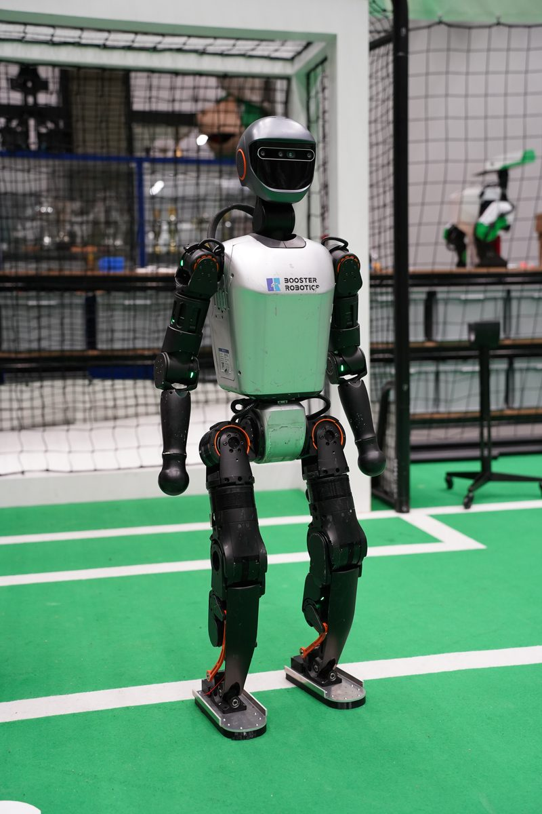
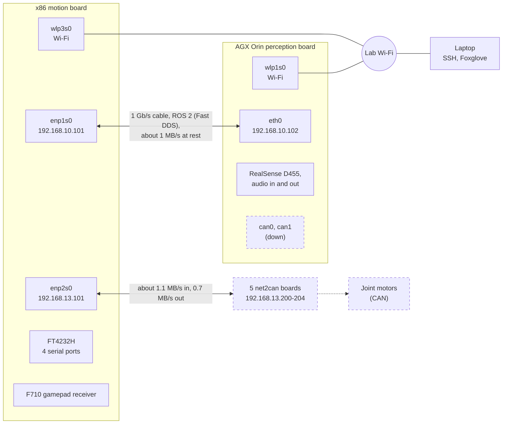
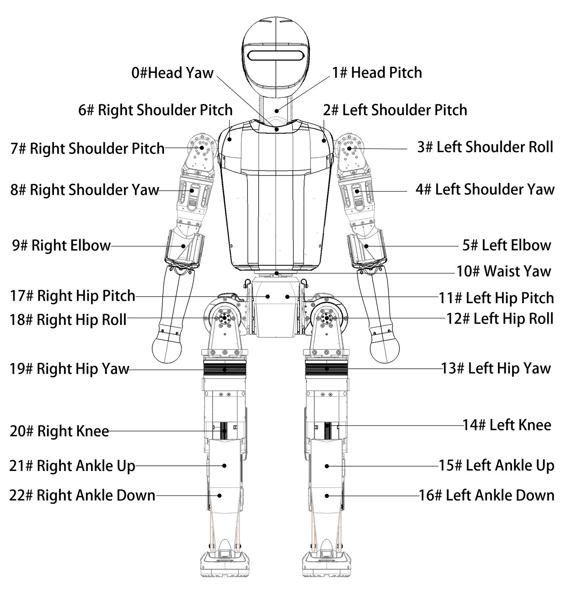
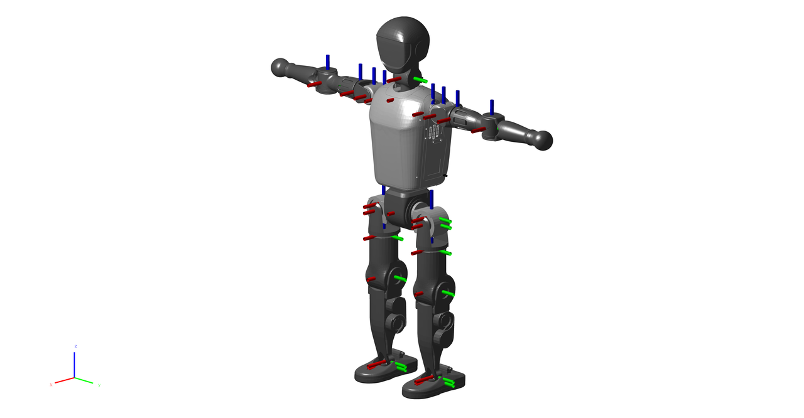
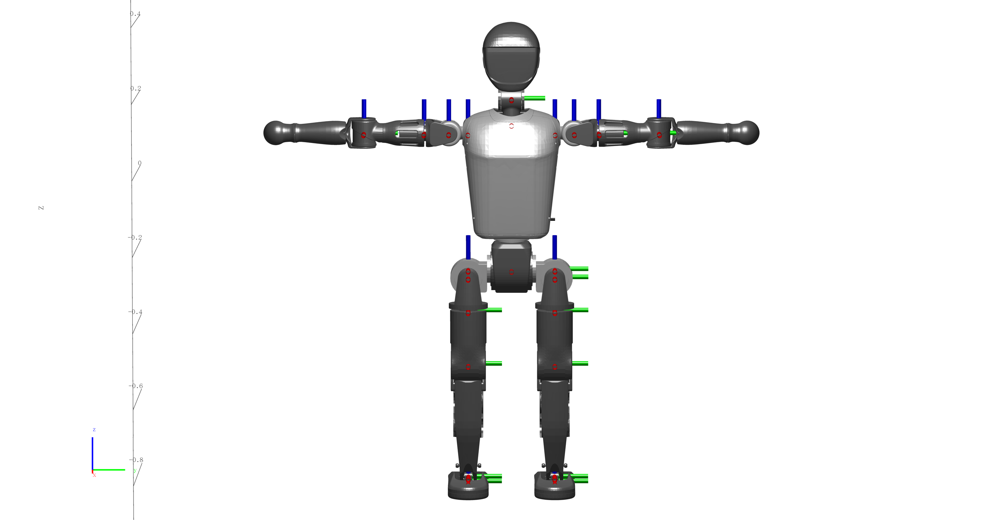

---
doc:
  quadrant: reference
  verified_on: "software 1.8.0.9, both boards"
---
# Hardware overview
COSMO is the humanoid service robot of Tech United @Home at Eindhoven University of Technology. It is a Booster T1 robot developed by Booster Robotics.

Robot number: TU-BT1-01

<figure markdown="span">
  { width="360" }<figcaption>COSMO (TU-BT1-01)</figcaption>
</figure>

## Computers

COSMO has two boards. Both run Ubuntu 22.04.5.

| Item           | x86 motion board                                          | AGX Orin perception board                                      |
| -------------- | --------------------------------------------------------- | -------------------------------------------------------------- |
| CPU            | Intel Core i7-1370PE, x86_64                              | Cortex-A78AE, aarch64                                          |
| Cores          | 14 (20 logical CPUs)                                      | 8                                                              |
| Max clock      | 4.80 GHz (performance cores), 3.90 GHz (efficiency cores) | 2.19 GHz (`lscpu` max, 2026-11-17)                             |
| Indicated AI performance | none                                                      | 200 TOPS                                                       |
| Network        | 2x gigabit Ethernet, Wi-Fi 6                              | 2x gigabit Ethernet, Wi-Fi 6                                   |
| RAM            | 7.5 Gi                                                    | 29 Gi                                                          |
| Root disk      | 468 G (`/dev/sda2`)                                       | 467 G (`/dev/nvme0n1p1`)                                       |
| Kernel         | `6.5.2-rt8` (real-time)                                   | `5.15.148-rt-tegra`                                            |
| L4T            | -                                                     | R36, revision 4.3                                              |
| Model string   | -                                              | `Booster T1 AGX Orin V2.1`                                     |
| CAN interfaces | none                                                      | `can0`, `can1` (built-in, `mttcan`); both DOWN, 0 bytes since boot |

### Network interfaces on the hardware level

| Board | Interface | State and role |
|---|---|---|
| x86 | `wlp3s0` | up, Wi-Fi, address `<x86-ip>` |
| x86 | `enp1s0` | up, wired, `192.168.10.101/24` |
| x86 | `enp2s0` | up, wired, `192.168.13.101/24`, to the five net2can motor boards (see [Motor bus](#motor-bus)) |
| x86 | `enp4s0` | down |
| Orin | `wlp1s0` | up, Wi-Fi, address `<orin-ip>` |
| Orin | `eth0` | up, wired, `192.168.10.102/24` |
| Orin | `can0`, `can1`, `l4tbr0`, `usb0`, `usb1` | down |

The wired addresses match the vendor manual V1.6 (`192.168.10.101` motion board, `192.168.10.102` perception board).

### Link between the boards

The two boards are joined by one direct Ethernet cable: x86 `enp1s0` to Orin `eth0`, subnet `192.168.10.x`. Each board sees the other as its only neighbour on that port. Measured 2026-11-17, robot idle shortly after boot:

| Item | Value |
|---|---|
| Link speed | 1000 Mb/s (gigabit), full duplex, MTU 1500, on both ends |
| Round-trip time (ping) | 0.5 ms average (0.15 to 0.63 ms) |
| Traffic at rest, x86 to Orin | about 0.97 MB/s |
| Traffic at rest, Orin to x86 | about 38 kB/s |
| Traffic while walking with perception running | [TBD] MB/s x86 to Orin, [TBD] MB/s Orin to x86 |
| Usable throughput (for example `iperf3`) | [TBD] Mb/s |
| Open TCP connections | one, x86 `:48154` to Orin `:20000` |
| Process on Orin port `20000` | [TBD] |
| Multicast route on x86 `enp1s0` | `239.255.76.67` (the LCM library default); user [TBD] |
| ROS 2 traffic | Fast DDS. Both boards' `/opt/booster/BoosterRos2/fastdds_profile.xml` allows UDP only on `127.0.0.1`, `192.168.10.101` and `192.168.10.102`, plus shared memory inside one board. So ROS 2 data between the boards crosses this cable, not Wi-Fi. |
| DDS profile of Booster's own processes | Orin: files under `/opt/booster/config/dds_configs/dual-board_configs/`, `ROS_DOMAIN_ID=0`. x86: [TBD] (processes run as root, not readable) |

`[TBD]` marks a value that has not been measured yet.

The gigabit speed is the line rate, about 125 MB/s at most. For scale: the raw head colour image at 30 Hz is about 83 MB/s and the raw depth image about 55 MB/s, so both raw streams together would not fit on this link. This is a calculation from the image sizes, not a measurement.

Solid line: observed. Dashed box or line: inferred, not observed directly (the net2can role comes from the packet counts and the config file; see [Other discoveries](#other-discoveries)). What the four FT4232H serial ports connect to is not known.

### USB devices

| Board | Device (USB ID) |
|---|---|
| x86 | FTDI FT4232H quad USB-UART (`0403:6011`) |
| x86 | STMicroelectronics device in DFU mode (`0483:df11`) |
| x86 | Intel AX210 Bluetooth (`8087:0032`) |
| x86 | Logitech F710 wireless gamepad receiver (`046d:c21f`) |
| Orin | Intel RealSense Depth Camera 455 (`8086:0b5c`) |
| Orin | C-Media USB audio device (`0d8c:0012`) |
| Orin | QinHeng USB single serial (`1a86:55d4`) |
| Orin | Fuzhou Rockchip `XFM-DP-V0.0.18` (`2207:0001`) |
| Orin | Intel AX210 Bluetooth (`8087:0032`) |
| Orin | Genesys Logic and Terminus hubs |

The FT4232H gives four serial ports, `/dev/ttyUSB0` to `/dev/ttyUSB3` (driver `ftdi_sio`). The STM device reports the product string `DFU in FS Mode` and serial number `204E315E574B`, and has no driver bound. 

## Robot specifications

| Item                    | Value                                                                                                                                                              |
| ----------------------- | ------------------------------------------------------------------------------------------------------------------------------------------------------------------ |
| Height, weight          | 118 cm, 30 kg                                                                                                                                                      |
| Degrees of freedom      | 23 (without grippers)                            |
| Battery                 | 10.5 Ah, up to 2 h of walking                                                                                                                                      |
| Head                    | depth camera, microphone array, speaker, yaw and pitch joints                                                                                                      |
| Safety settings                  | automatic damping in uncontrolled states, Physical emergency stop on the back of the robot                                                                                                          |

## Sensors

### Head RGB-D camera

| Item | Value |
|---|---|
| Model | Intel RealSense D455, USB ID `8086:0b5c`, on the Orin |
| Colour image | 1280x720, `rgb8`, 2,764,800 B per frame, 30 Hz |
| Depth image | 1280x720, `16UC1`, 1,843,200 B per frame, 30 Hz |
| Depth alignment | Aligned to the colour image. The driver runs with `align_depth.enable:=true`, so pixel (u, v) in colour and depth is the same point (software 1.6.2.2). |
| Frame id | `head_color_optical_frame` |
| Intrinsics, colour and depth | fx 641.872, fy 640.972, cx 649.481, cy 360.347; distortion model `plumb_bob`, d = [-0.05405, 0.06291, -0.00066, 0.00092, -0.01983] |
| Driver format settings | depth Z16, colour RGB8 [UNVERIFIED] |
| Streams disabled in the driver | camera IMU (accel, gyro), infrared (software 1.6.2.2) |
| Unaligned depth, compressed (`.../depth/image_rect_raw/compressedDepth`) | 33.2 Hz, 145,936 B average payload (1.8.0.9) |
| `camera_info` publication | 30 Hz; 384 B per message (software 1.6.2.2) |
| QoS of the colour and depth image topics | RELIABLE, TRANSIENT_LOCAL |

Topic names and rates: see [[ros-interfaces]].

### IMU

- The topic `/imu/data` (`sensor_msgs/msg/Imu`) publishes at 500 Hz in the frame `trunk`. At rest `linear_acceleration.z` is 9.79.

### Audio

- The Orin has a C-Media USB audio device (see table above); it is playback only. The iFlytek `XFM-DP-V0.0.18` USB audio device (Rockchip ID in the table above) is capture only.

## Actuators and joints

`/joint_states` reports 23 joints on 1.8.0.9, in this order.

| # | ROS joint name |
|---|---|
| 1 | `aahead_yaw_joint` |
| 2 | `aahead_pitch_joint` |
| 3 | `left_shoulder_pitch_joint` |
| 4 | `left_shoulder_roll_joint` |
| 5 | `left_elbow_pitch_joint` |
| 6 | `left_elbow_yaw_joint` |
| 7 | `right_shoulder_pitch_joint` |
| 8 | `right_shoulder_roll_joint` |
| 9 | `right_elbow_pitch_joint` |
| 10 | `right_elbow_yaw_joint` |
| 11 | `waist_yaw_joint` |
| 12 | `left_hip_pitch_joint` |
| 13 | `left_hip_roll_joint` |
| 14 | `left_hip_yaw_joint` |
| 15 | `left_knee_pitch_joint` |
| 16 | `left_ankle_pitch_joint` |
| 17 | `left_ankle_roll_joint` |
| 18 | `right_hip_pitch_joint` |
| 19 | `right_hip_roll_joint` |
| 20 | `right_hip_yaw_joint` |
| 21 | `right_knee_pitch_joint` |
| 22 | `right_ankle_pitch_joint` |
| 23 | `right_ankle_roll_joint` |

Groups: head 2, each arm 4, waist 1, each leg 6. The head yaw joint is spelled `aahead_yaw_joint`, with the double `a`.

### Joint limits

> [!warning] Review needed
> This section has not been reviewed by the team yet.

Limits are in degrees. The index starts at 0; the `/joint_states` number in the last column starts at 1. "Configured" is the position limit in the robot's `/opt/booster/configs/robot_config.yaml`. "Vendor manual" is the limit in the vendor manual V1.1, which has fewer digits. Where the two differ by a degree or more, the vendor value is in bold and is the narrower one.

> [!warning]
> Stay inside the narrower of the two ranges. [UNVERIFIED] The robot may not stop a joint at these limits: in the robot's safety settings the position limit check is switched off.

| Index | Joint name | Configured | Vendor manual | ROS joint (`/joint_states` #) |
|---|---|---|---|---|
| 0 | Head Yaw | -58 to 58 | -58 to 58 | `aahead_yaw_joint` (1) |
| 1 | Head Pitch | -18 to 47 | -18 to 47 | `aahead_pitch_joint` (2) |
| 2 | Left Shoulder Pitch | -188 to 68 | -188 to 68 | `left_shoulder_pitch_joint` (3) |
| 3 | Left Shoulder Roll | -114.6 to 88 | **-94 to 88** | `left_shoulder_roll_joint` (4) |
| 4 | Left Shoulder Yaw | -128 to 128 | -128 to 128 | `left_elbow_pitch_joint` (5) |
| 5 | Left Elbow | -120 to 2 | -120 to 2 | `left_elbow_yaw_joint` (6) |
| 6 | Right Shoulder Pitch | -188 to 68 | -188 to 68 | `right_shoulder_pitch_joint` (7) |
| 7 | Right Shoulder Roll | -88 to 114.6 | **-88 to 94** | `right_shoulder_roll_joint` (8) |
| 8 | Right Shoulder Yaw | -128 to 128 | -128 to 128 | `right_elbow_pitch_joint` (9) |
| 9 | Right Elbow | -2 to 120 | -2 to 120 | `right_elbow_yaw_joint` (10) |
| 10 | Waist Yaw | -58 to 58 | -58 to 58 | `waist_yaw_joint` (11) |
| 11 | Left Hip Pitch | -118 to 118 | -118 to 118 | `left_hip_pitch_joint` (12) |
| 12 | Left Hip Roll | -32.5 to 88 | **-21 to 88** | `left_hip_roll_joint` (13) |
| 13 | Left Hip Yaw | -58 to 58 | -58 to 58 | `left_hip_yaw_joint` (14) |
| 14 | Left Knee | -11.5 to 123 | **0 to 123** | `left_knee_pitch_joint` (15) |
| 15 | Left Ankle Up | -23.2 to 49.1 | -23 to 49 | `left_ankle_pitch_joint` (16) |
| 16 | Left Ankle Down | -24.5 to 45.1 | -24 to 45 | `left_ankle_roll_joint` (17) |
| 17 | Right Hip Pitch | -118 to 118 | -118 to 118 | `right_hip_pitch_joint` (18) |
| 18 | Right Hip Roll | -88 to 32.5 | **-88 to 21** | `right_hip_roll_joint` (19) |
| 19 | Right Hip Yaw | -58 to 58 | -58 to 58 | `right_hip_yaw_joint` (20) |
| 20 | Right Knee | -11.5 to 123 | **0 to 123** | `right_knee_pitch_joint` (21) |
| 21 | Right Ankle Up | -23.2 to 49.1 | -23 to 49 | `right_ankle_pitch_joint` (22) |
| 22 | Right Ankle Down | -24.5 to 45.1 | -24 to 45 | `right_ankle_roll_joint` (23) |

The ROS joint is the `motor_name` that the configuration gives to the same index. [UNKNOWN] Whether the ankle limits (15, 16, 21, 22) apply to the ankle pitch and roll of `/joint_states`: the vendor calls these joints Ankle Up and Ankle Down, the two motors that drive the ankle together.

*Joint layout, front view, with the joint indices. The drawing labels joint 7 "Right Shoulder Pitch"; it is the right shoulder roll.*

*3D view with the joint axes at the zero position: X red, Y green, Z blue.*

*Front view in the zero pose, with joint axes and a height scale in metres on the left.*

### Motor state

The message `booster_interface/msg/LowState` carries two motor arrays, `motor_state_serial` and `motor_state_parallel`.

| Field | Meaning |
|---|---|
| `temperature` | Filled only in `motor_state_parallel` (30 to 38 C). In `motor_state_serial` it reads 0 for all 23 motors. |
| `reserve[0]` | Error flag (from the message definition) |
| `reserve[1]` | Communication frequency (from the message definition) |

Rates on 1.8.0.9: `/joint_states` 500 Hz (1228 B per message), `/low_state` 500 Hz (1704 B).

`LowState` is `imu_state` (`rpy`, `gyro`, `acc`) plus the two motor arrays. Each `MotorState` has `mode`, `q`, `dq`, `ddq`, `tau_est`, `temperature`, `lost` and `reserve[2]`.

### Motor bus

The x86 board's configuration `/opt/booster/configs/robot_config.yaml` describes the motor side. Its section `net2can_config` lists five boards, index 0 to 4 (index 0 `board_type` 3, the others `board_type` 1, firmware 2.0.5). Each joint entry names a `can_channel` and a `can_id`:

| Joints | `can_channel` | `can_id` | Motor model |
|---|---|---|---|
| Head yaw, head pitch | 0 | 1, 2 | not named (joint `type` 3) |
| Waist yaw | 1 | 1 | 6408 |
| Left hip pitch, roll, yaw | 4 | 3, 2, 1 | 8112, 6408, 6408 |
| Left knee, ankle pitch, ankle roll | 5 | 3, 2, 1 | 8116, 4315, 4315 |
| Right hip pitch, roll, yaw | 7 | 3, 2, 1 | 8112, 6408, 6408 |
| Right knee, ankle pitch, ankle roll | 8 | 3, 2, 1 | 8116, 4315, 4315 |
| Left shoulder pitch, shoulder roll | 10 | 2, 1 | 4310 |
| Left elbow pitch, elbow yaw | 11 | 2, 1 | 4310 |
| Right shoulder pitch, shoulder roll | 13 | 2, 1 | 4310 |
| Right elbow pitch, elbow yaw | 14 | 2, 1 | 4310 |

Each joint entry also sets `direction`, `zero_pos`, `cmd_torque_per_cnt` and a position limit (`min_position`, `max_position`, `security_level`). The comment lines above each group in the file use different channel numbers than the `can_channel` values; the table follows the values.

### Other discoveries

- Motor IDs start with a number and `#`: 36 for 4310, 60 for 6408, 90 for 8112, 130 for 8116, 50 for 4315. `motor_calib.yaml` labels a 36 motor "Encos Motor 36NM". The number is the rated torque in N·m and the motors are Encos motors. The largest, the knee `8116`, is rated 130 N·m. The motors have a hollow axis and two encoders (position and velocity).
- The x86 board's second wired port `enp2s0` (`192.168.13.101/24`) has five reachable neighbours, `192.168.13.200` to `192.168.13.204`. The port carries about 12,500 packets per second in (1.1 MB/s) and 5,500 out (0.68 MB/s). These five devices are the five net2can boards, network-to-CAN gateways between the x86 board and the motors. Basis: the count matches, the section name, and the steady packet rate.
- The four FTDI serial ports are named, among other generic port names, inside `device_gateway`, `robot_core`, `server_motion` and `booster-server`. 
- The Orin's `can0` and `can1` are the AGX Orin's built-in controllers (driver `mttcan`). Both are STOPPED with no bitrate set and 0 bytes received or sent since boot.
- The x86 board has the udev rules of PEAK-System USB-CAN adapters (`/etc/udev/rules.d/45-pcan.rules`), but no PEAK driver is loaded and no PEAK device is present.

### URDF and meshes

The robot carries an official URDF at `/opt/booster/Gait/configs/T1/robot.urdf` on the x86 board (robot name `V23RobotAsm`, first link `Trunk`, mass value 11.7). `/opt/booster/Gait/configs` also holds `K1`, `T1_7DofArm`, `T2`, `T2_Hand` and `booster_assets`.

## Power and battery

| Item                    | Value                                                                                             |
| ----------------------- | ------------------------------------------------------------------------------------------------- |
| Topic                   | `/battery_state`, type `booster_interface/msg/BatteryState`, 1 publisher, 2 subscribers (1.8.0.9) |
| Field `voltage`         | `float32`                                                                                         |
| Field `current`         | `float32`                                                                                         |
| Field `soc`             | `float32`                                                                                         |
| Field `average_voltage` | `float32`                                                                                         |
| Battery daemon          | `battery_daemon` runs on the Orin, started by Booster's `containerd`                              |

On mains power, the robot publishes no message on `/battery_state`.
The robot has a team-customised power system, and a battery comes with the test power setup.

[UNKNOWN] The scale of `soc` (0-1 or 0-100), and the message content while on battery.
