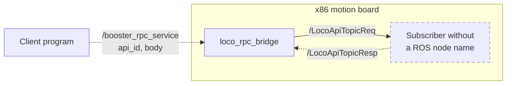

---
doc:
  quadrant: reference
  verified_on: "software 1.8.0.9, both boards"
---
# RPC API

The RPC API is how a program gives COSMO high-level commands, such as changing the mode or moving the head. A request carries a number, the `api_id`, and a `body` with the parameters. Values marked (software 1.6.2.2) were not checked on 1.8.0.9.

> [!warning]
> Calls on this page can move COSMO. Do not publish to the `*ApiTopicReq` topics directly. Keep the joystick in hand, see [[control_with_joystick]].

## How a command reaches the robot

- The service `/booster_rpc_service` (`booster_interface/srv/RpcService`) is visible from both boards. [INFERENCE] `loco_rpc_bridge` on the x86 board serves it.
- A mode command sent to the service also appears on `/LocoApiTopicReq`, and `loco_rpc_bridge` logs `API_ID: 2000`.
- `/LocoApiTopicReq` has 10 publishers, `loco_rpc_bridge` and 9 DDS programs without a ROS node name, and 1 subscriber. [UNKNOWN] Which publisher sends a given request.

Solid line: observed. Dashed box or line: inferred, not observed directly.

## Message format

### Service

| Part | Field | Type |
|---|---|---|
| Request `BoosterApiReqMsg msg` | `api_id` | `int64` |
| Request `BoosterApiReqMsg msg` | `body` | `string` |
| Response `BoosterApiRespMsg msg` | `status` | `int64` |
| Response `BoosterApiRespMsg msg` | `body` | `string` |

### Topics

Each request topic `<name>Req` has a response topic `<name>Resp`. The response repeats the `uuid` of the request (software 1.6.2.2).

| Message | Field | Content (software 1.6.2.2) |
|---|---|---|
| `booster_msgs/msg/RpcReqMsg` | `uuid` | Identifier of the request |
| `booster_msgs/msg/RpcReqMsg` | `header` | JSON text, e.g. `{"api_id":2022,"expect_response":true}` |
| `booster_msgs/msg/RpcReqMsg` | `body` | Parameters as text; empty for `api_id` 2022 |
| `booster_msgs/msg/RpcRespMsg` | `uuid` | Same as the request |
| `booster_msgs/msg/RpcRespMsg` | `header` | JSON text, e.g. `{"status":0}` |
| `booster_msgs/msg/RpcRespMsg` | `body` | JSON text |

## Calls

### Calls used on COSMO

| `api_id` | Name | Body | Result |
|---|---|---|---|
| 2000 | `kChangeMode` | `mode` (integer) | Prepare and Damping return status 0. After Prepare, `current_mode` in `/robot_states` is 1. [UNKNOWN] Walking. **Changes robot state** |
| 2004 | `kRotateHead` | `pitch`, `yaw` | The command "centre" is forwarded and the camera view moves. [UNKNOWN] The direction signs. **Changes robot state** |
| 2022 | `kGetRobotInfo` | empty | Status 0; the body has `edition`, `model`, `nickname`, `region`, `serial_number` and `version` (software 1.6.2.2) |

The body is JSON text. [UNVERIFIED] The body fields come from the Loco API header on the x86 board.

### Other calls in the Loco API header

The header is `/opt/booster/python3/site-packages/include/booster/robot/b1/b1_loco_api.hpp` on the x86 board. [UNVERIFIED] These calls have not been tried on COSMO; a name in the header does not mean the T1 supports the call.

| `api_id` | Name | Group |
|---|---|---|
| 2001 | `kMove` | Walking |
| 2031 | `kResetOdometry` | Walking |
| 2042 | `kSwitchGait` | Walking |
| 2006, 2043 | `kRotateHeadWithDirection`, `kRotateHeadWithTime` | Head |
| 2007, 2008, 2025 | `kLieDown`, `kGetUp`, `kGetUpWithMode` | Lie down and get up |
| 2009, 2037, 2023 | `kMoveHandEndEffector`, `kMoveDualHandEndEffector`, `kStopHandEndEffector` | Arms |
| 2030 | `kUpperBodyCustomControl` | Arms |
| 2010, 2013 | `kControlGripper`, `kControlDexterousHand` | Hands |
| 2005, 2015, 2016 | `kWaveHand`, `kHandshake`, `kDance` | Gestures |
| 2026, 2027, 2028 | `kZeroTorqueDrag`, `kRecordTrajectory`, `kReplayTrajectory` | Trajectories |
| 2020, 2021 | `kPlaySound`, `kStopSound` | Sound |
| 2011 | `kGetFrameTransform` | Query |
| 2017, 2018 | `kGetMode`, `kGetStatus` | Query |
| 2044, 2045, 2046 | `kGetSensors`, `kGetHands`, `kGetRobotModel` | Query |

[UNKNOWN] Whether COSMO keeps its velocity after one `kMove` call, and how it stops.

### Mode numbers

| Number | Mode |
|---|---|
| 0 | Damping [INFERENCE] |
| 1 | Prepare |
| 2 | Walking |
| 3 | Custom |

1, 2 and 3 are in the comments of `/opt/booster/Gait/configs/T1/command_config.toml` on the x86 board. [INFERENCE] `current_mode` in `/robot_states` uses the same numbers.

### Status codes

| Status | Meaning |
|---|---|
| 0 | Success |

[UNKNOWN] All other status codes.

## Request and response topics

| Family | Topics |
|---|---|
| Loco | `/LocoApiTopicReq`, `/LocoApiTopicResp`, `/LocoApiOperationEvent` (no request topic) |
| Camera | `/CameraApiTopicReq`, `/CameraApiTopicResp` |
| Hand-eye calibration | `/HandEyeCalibApiTopicReq`, `/HandEyeCalibApiTopicResp` |
| Lights | `/LightControlApiTopicReq`, `/LightControlApiTopicResp` |
| Audio | 35 pairs under `/booster/audio/` |
| Other | `/daemon_locomotion`, `/wifi_connect` and `/zero_pose_set`, each with `Req` and `Resp` |

The full list is in [[ros-interfaces#RPC request and response topics]]. [UNKNOWN] The `api_id` values of the families other than Loco.
