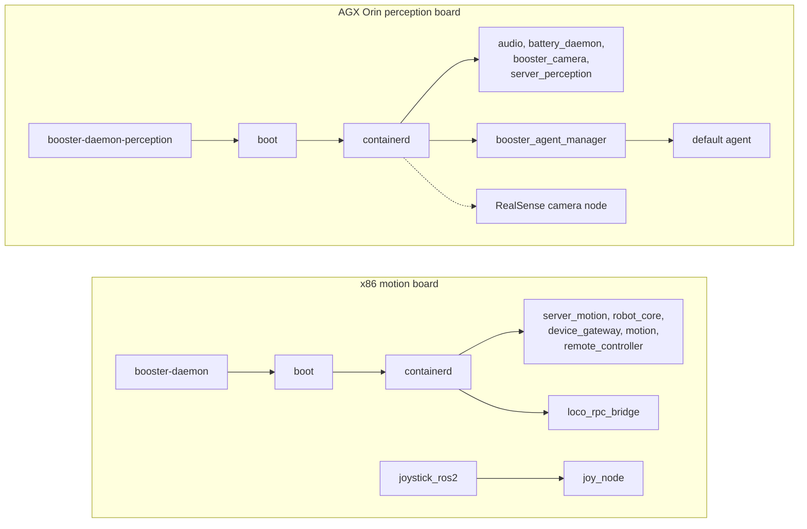

---
doc:
  quadrant: reference
  verified_on: "software 1.8.0.9, both boards"
---
# Software overview

This page describes the software on COSMO's two boards: the versions, which program runs on which board, the ROS 2 environment, the network ports and the Booster agents. Values marked (software 1.6.2.2) were not checked on 1.8.0.9.

Hardware: [[hardware-overview]]. Topics and messages: [[ros-interfaces]]. Request and response calls: [[rpc_api]].

## Software versions

| Item             | x86 motion board                          | AGX Orin perception board                 |
| ---------------- | ----------------------------------------- | ----------------------------------------- |
| Booster software | `1.8.0.9-release-02011-2026-09-14-global` | `1.8.0.9-release-02011-2026-09-14-global` |
| Operating system | Ubuntu 22.04.5                            | Ubuntu 22.04.5                            |
| L4T              | -                                         | R36, revision 4.3                         |
| JetPack          | -                                         | 6.2                                       |
| ROS 2            | Humble                                    | Humble                                    |
| Python           | 3.10.12                                   | 3.10.12                                   |
| Time zone        | `Europe/Rome`                             | `Europe/Amsterdam`                        |

Both clocks are synchronised and both time zones give the same local time.

`/opt/booster/version.txt` on each board is an install history; the last `Version:` line is the current software.

`/opt/booster/robot_info.txt`, on the x86 board only, has the line `Model Version: 2.3.4`. [INFERENCE] This is the version of the robot model, not of the software. The Orin has `/opt/booster/perception_info.yaml`, which names the camera.

### AI libraries on the Orin

| Library | Version |
|---|---|
| CUDA toolkit | 12.6 |
| TensorRT | 10.3.0 |
| PyTorch | 2.7.0 |
| ONNX Runtime GPU | 1.22.0 |
| OpenCV (`opencv-python`) | 4.11.0.86 |
| Ultralytics | 8.3.156 |
| NumPy | 1.21.5 |

## Programs

### Start-up

On each board one systemd service runs `/opt/booster/bin/script/boot`. That script starts Booster's own `/opt/booster/bin/containerd`, which starts the Booster programs. It is not Docker's `/usr/bin/containerd`.

| Item | x86 motion board | AGX Orin perception board |
|---|---|---|
| systemd service | `booster-daemon` | `booster-daemon-perception` |
| `containerd` endpoint name | `dual_board_motion` | `dual_board_perception` |
| Other Booster services | `booster-btmon`, `booster-update-engine`, `joystick_ros2` | `booster-update-engine`, `booster-upd72020x-check` |

`booster-daemon` has `Restart=always`: systemd starts it again 5 seconds after it exits.



Solid line: observed. Dashed line: inferred, not observed directly (the camera launch file runs under `containerd`; one parent process was not seen).

### Programs per board

| Program | Board | Detail |
|---|---|---|
| `server_motion`, `robot_core`, `device_gateway`, `motion`, `remote_controller`, `rs_message` | x86 | Started by `containerd`, run as root. |
| `login_daemon`, `containerd_gateway` | x86 | Started by `containerd`, run as root. |
| `loco_rpc_bridge` | x86 | `rpc_service_node` of the package `booster_rpc_bridge`, started by `rpc_bridge_launch_motion.py`. Runs as root. See [[rpc_api]]. |
| `joy_node` | x86 | Stock `ros-humble-joy`. `joystick_ros2.service` runs `/opt/booster/BoosterShell/start_joystick.sh` as root. |
| `battery_daemon`, `server_perception` | Orin | Started by `containerd`, run as root. |
| `booster_camera`, `audio` | Orin | Started by `containerd`, run as the board's normal user. |
| `booster_agent_manager` | Orin | Started by `containerd`. Runs the default agent. |
| RealSense camera node | Orin | Node `/boostercamera/camera`, started through `booster_camera.launch.py`. Built from source in the user's home folder. |
| `lui`, `rtc_client`, video stream | Orin | Installed, not running. [INFERENCE] The voice and video-stream topics are missing for this reason. |

### Folders

| Folder or file | x86 motion board | AGX Orin perception board |
|---|---|---|
| `/opt/booster` (selected) | `Gait`, `RobotCore`, `RemoteController`, `BoosterShell`, `BoosterServer`, `DeviceGateway`, `Daemon` | `BoosterAgent`, `BoosterAudio`, `BoosterFaceDetection`, `BoosterLui`, `ServerPerception`, `booster_agent_data` |
| `/opt/booster/configs` | `motor_calib.yaml`, `robot_config.yaml`, `security_config.yaml`, `system_settings_config.yaml` | `perception_settings_config.yaml` |

## ROS 2 environment

The two boards share one ROS 2 graph: each board lists topics whose hardware is on the other board.

### Load the Booster message types

The Booster message types are in four workspaces on the Orin.

```bash
source /opt/ros/humble/setup.bash
source /opt/booster/BoosterRos2/install/setup.bash
source /opt/booster/BoosterFaceDetection/install/setup.bash
source /opt/booster/BoosterAgent/install/setup.bash
source /opt/booster/BoosterRos2Interface/install/setup.bash
```

Types that still have no definition are listed in [[ros-interfaces#Message packages]].

### Fast DDS profile

The login shells on both boards use `/opt/booster/BoosterRos2/fastdds_profile.xml`. The file is identical on both boards.

| Item | Value |
|---|---|
| UDP | only on `127.0.0.1`, `192.168.10.101` and `192.168.10.102` |
| Shared memory (SHM) | on, inside one board |
| `useBuiltinTransports` | `false` |
| `data_sharing` | AUTOMATIC |
| `ROS_DOMAIN_ID` | not set (default 0) |
| `ROS_LOCALHOST_ONLY` | 0 |

Both boards also have `fastdds_profile_udp_only.xml` in the same folder.

Most of Booster's own ROS programs on the Orin use another file, `/opt/booster/config/dds_configs/dual-board_configs/fastdds_profile.xml`. [UNKNOWN] Whether it differs from the profile of the login shells, and which profile the x86 programs use.

- [INFERENCE] A laptop on Wi-Fi cannot subscribe to the topics directly, because the profile allows no Wi-Fi address.
- A `foxglove_bridge` on the Orin is an off-board route that works. Foxglove on the laptop reads it over a WebSocket.

> [!warning]
> A `foxglove_bridge` 3.3.0 without settings lets every client publish to any topic, call services and set parameters, including commands that move COSMO. Restrict `topic_whitelist`, `client_topic_whitelist`, `service_whitelist`, `param_whitelist` and `capabilities`. [UNKNOWN] The defaults of version 3.6.0.

## Network ports

Addresses and cables: [[hardware-overview#Network interfaces on the hardware level]].

| Port (TCP) | Board | Used by |
|---|---|---|
| 6868, 16888, 16889 | Orin | `booster_agent_manager` |
| 8767 | Orin | our `foxglove_bridge`, when started |
| 20000 | Orin | [UNKNOWN]; the x86 board holds a connection to it |
| 22, 111, 4750, 20107, 50053 | Orin | not visible without root |
| 5345, 40431 (localhost only) | Orin | not visible without root |
| 20011 | x86 | `containerd_gateway` |
| 20001 (localhost only) | x86 | `containerd` (address given to `containerd_gateway`) |
| 22, 20000, 20107, 50051, 50052, 51111, 51112, 51113 | x86 | not visible without root |
| 631 (localhost only) | x86 | not visible without root |

## Booster agents

An agent is a robot-side application. `booster_agent_manager` on the Orin runs the active one, by default `com.boosterobotics.default`. Starting an agent can make COSMO move.

| Item | Value |
|---|---|
| Agents on the Orin | `ai_chat`, `dance_demo`, `default`, `soccer`, `teaching` (prefix `com.boosterobotics.`) |
| Agent files | `/opt/booster/booster_agent_data/data/agents/`, with `autoinstall`, `extract`, `installed` and `store_downloads` |
| Framework packages | `booster_agent_framework_node`, `booster_agent_interface`, `booster_agent_manager`, `booster_agent_pyruntime` |
| Telemetry topic | `/booster/agent/system/telemetry_msg` (`std_msgs/msg/String`) |

`multi_voice_agent`, inside `ai_chat`, is a compiled program. [INFERENCE] It is the voice agent.

[UNKNOWN] Whether third-party agents are supported, how an agent moves from `extract` to `installed`, and what the service type `AgentService` is for.

## Known problems

| Symptom | Cause | Fix |
|---|---|---|
| A `foxglove_bridge` on the Orin shows no camera topics, while x86 topics arrive (software 1.6.2.2) | The shared-memory transport in the Fast DDS profile. [UNKNOWN] Why `ros2 topic echo` does receive them | Start the bridge with a UDP-only copy of the profile, with the same addresses and `data_sharing` OFF, through `FASTRTPS_DEFAULT_PROFILES_FILE` |
| A bridge on port 8765 stops with `Bind Error` (software 1.6.2.2) | `ros_bridge_serv` holds the port. [INFERENCE] It belongs to Booster Studio | Use another port, for example 8767 |
| The bridge repeats `bad optional access` and advertises fewer topics (software 1.6.2.2) | [INFERENCE] A whitelisted topic has a type without a definition | Leave those topics out of `topic_whitelist` |
